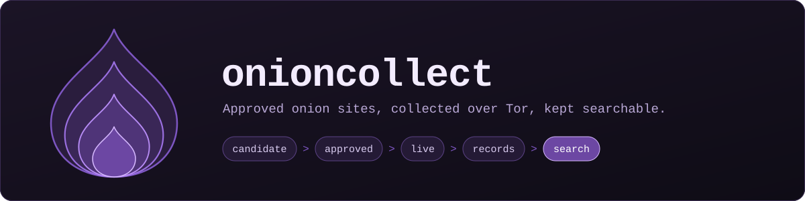

<p align="center">
  
</p>

<h1 align="center">onioncollect</h1>

<p align="center">Collects public pages from approved onion sites over Tor and makes them searchable.</p>

<p align="center">
  <a href="https://github.com/moonrunnerkc/onioncollect/actions/workflows/ci.yml"></a>
  
  
  
</p>

<p align="center">
  <a href="#what-it-does">What it does</a> ·
  <a href="#setup">Setup</a> ·
  <a href="#running-commands">Running commands</a> ·
  <a href="#add-a-source">Add a source</a> ·
  <a href="#everyday-use">Everyday use</a> ·
  <a href="#search">Search</a> ·
  <a href="#what-it-will-not-do">Limits</a> ·
  <a href="#more-docs">More docs</a>
</p>

## What it does

You give it an onion address. A person approves it, writes a small config that says what to pull from the page,
and the crawler takes over from there.

- **Sources are safe, public ones.** News sites' onion mirrors, SecureDrop directory pages, the Tor Project,
  Debian, privacy services.
- **Nothing is fetched until a human approves it** and it passes a go-live check.
- **Everything goes through Tor.** A firewall in the VM drops anything that tries to go around it.
- **Secrets are removed before anything is stored.** Emails, passwords, card numbers and tokens are redacted,
  then checked a second time on write.
- **Every source has a health score.** If a site changes its layout and records stop coming, you get a queue
  item to deal with.

One operator, one VM, one Python process.

## Setup

You need a Mac with [Lima](https://lima-vm.io), Python 3.13, and FileVault turned on.

```bash
make venv        # local virtualenv, pinned and hash-checked
make test        # unit and boundary tests, no network needed
make provision   # builds the VM: Debian 13, six Tor instances, the firewall
```

Before the first deploy, put two files in the repo root. Both are gitignored, and the crawler refuses to start
without them:

| File | What goes in it |
| --- | --- |
| `exclusions.txt` | Onion hosts that must never be fetched, one per line |
| `safety-patterns.txt` | Patterns that shut a source off if its page matches |

Then deploy:

```bash
make deploy      # installs the code, runs the four leak tests, starts the crawl timer
make checklist   # confirms the VM is locked down
```

Wait about 15 minutes between `make provision` and `make deploy`. The leak tests can fail on leftover package
download traffic until then.

After that it runs itself. The crawl fires every 15 minutes and only fetches what is due.

## Running commands

There are two users in the VM. Each one can only do its own job.

| User | Does | Open a shell |
| --- | --- | --- |
| `analyst` | Approves sources, searches, works the health queue | `limactl shell node1 sudo -iu analyst` |
| `crawler` | Fetches over Tor, runs go-live | `make shell` |

Once you are in, set a shortcut. The rest of this page uses it:

```bash
cd /opt/onioncollect/app
alias oc='/opt/onioncollect/venv/bin/python -m onioncollect --settings ~/settings.toml'
oc --help
```

## Add a source

**1. Put the address in the queue** (analyst). Nothing is fetched yet.

```bash
oc triage request <address>.onion --found-at "linked from debian.org"
oc triage list
```

**2. Approve or decline it** (analyst). A decline is final.

```bash
oc triage approve <address>.onion --as debian --category software-infrastructure --note "official Debian mirror"
oc triage decline <address>.onion --reason "could not confirm who runs it"
```

Categories: `journalism-publishing`, `software-infrastructure`, `privacy-services`, `directories`, `self-hosted`.

**3. Fill in the config** (analyst). Approving creates a starter file in `/var/lib/onioncollect/configs`.
Tell it which pages to start on and which CSS selectors hold the data:

```toml
id = "debian"
hosts = ["<address>.onion"]
category = "software-infrastructure"
cadence = "12h"
seeds = ["/debian/dists/"]

[listing]
item = 'tr:has(img[alt="[DIR]"])'

[listing.fields]
release = "td a"
last_modified = 'td[align="right"]'

[expect]
min_items_per_page = 10
required_fields = ["release", "last_modified"]

[auth]
type = "none"
```

```bash
oc config validate debian
```

**4. Go live** (crawler). This fetches the seed pages once and checks that the config really finds records.

```bash
oc golive debian
```

A pass looks like this. Any `FAIL` line tells you what to fix, and the source stays off until it passes.

```text
PASS  state is approved (found approved)
PASS  hosts: 1 valid v3, all approved for this source
PASS  policy: journalism-publishing, reviewer note on file
PASS  leak tests: all 4 passed 1 h ago, run by unit
PASS  reachability: 2 of 2 instances
PASS  seed 1: status 200
PASS  seed 1: 53 complete items of 10 expected, hit rate 0.70, redaction events 0
PASS  mirror: no other source matches
PASS  baseline: 1 snapshots written, bbc-news is live
```

Copy the finished config back into `configs/` and commit it. That folder is the reviewed record of what gets
collected.

## Everyday use

As the analyst:

```bash
oc sources list                 # every source and its state
oc health                       # what needs attention, most urgent first
oc health runs debian           # one source's recent runs and hit rates
oc health log                   # every decision made on a health item
```

As the crawler:

```bash
oc crawl status                 # queue sizes and Tor health
```

When a health item shows up, fix the cause and then close it with a note. There are four ways to close one:

| Disposition | Use it when | Run as |
| --- | --- | --- |
| `fixed` | You repaired the config. The source is re-checked before it closes. | crawler |
| `mirror-swapped` | The host is down and another approved host is up. Add `--to <host>`. | crawler |
| `watching` | It may be a blip. Add `--runs 5` to wait five runs. | analyst |
| `disabled` | The source should stop being collected. | analyst |

```bash
oc health resolve 12 --disposition fixed --note "listing selector updated for the new layout"
```

Useful `make` targets from the Mac:

| Command | What it does |
| --- | --- |
| `make deploy` | Ship code and config changes. Always ends with the leak tests. |
| `make leak-test` | Run the four Tor leak tests now |
| `make snapshot` | Save a copy of the VM disk to roll back to |
| `make test` | Run the test suite locally |

If the leak tests are older than 36 hours, or older than the last deploy, the crawler will not fetch.

## Search

From the command line, as the analyst:

```bash
oc search "trixie"
oc search "release" --source debian --since 2026-11-01
```

Or in a browser. The search page only listens inside the VM, so forward the port from your Mac:

```bash
ssh -F ~/.lima/node1/ssh.config -N -L 8470:127.0.0.1:8470 lima-node1
```

Then open <http://127.0.0.1:8470/>. It is read-only: it cannot write to the stores or reach the network.

## What it will not do

These are fixed in code and held by tests, not left to settings.

- Fetch a host nobody approved, or follow a redirect
- Log in, submit a form, solve a captcha, post, message or buy anything
- Download files. HTML and plain text only, 2 MB at most.
- Store a password, email, card number or token in the clear
- Send a single packet outside Tor
- Try to identify or locate anyone

The one exception is a test onion site the operator hosts on a second VM (`make testonion`). The crawler logs
in there, with the operator's own account, to prove the login code is fenced in.

## More docs

| Read this | For |
| --- | --- |
| [docs/build-guide.md](docs/build-guide.md) | The full design and the source policy |
| [docs/writeup.md](docs/writeup.md) | What collecting taught me |
| [provision/README.md](provision/README.md) | How the VM is built, every `make` target, file layout |
| [testonion/](testonion/) | The self-hosted test site and its two configs |
| [tests/test_network_boundary.py](tests/test_network_boundary.py) | The boundary tests that hold the rules above |
| [tests/live/leak_test.sh](tests/live/leak_test.sh) | The four Tor leak tests |
